# Análise de tráfego e detecção de port scan


## Sobre o projeto

Esse é o primeiro projeto da minha sequência semanal de segurança em cima do meu home lab ([homelab-firewall](https://github.com/isabella18pgdc/homelab-firewall)). A ideia foi capturar tráfego real da minha rede com o tcpdump e depois analisar essas capturas no Wireshark, em vez de só ler sobre como um port scan se parece.

Fiz duas capturas na Ubuntu Server: uma de navegação comum (DNS, HTTP e HTTPS) e outra de um SYN scan do nmap contra o meu próprio firewall. Depois comparei as duas no Wireshark, olhando pacote por pacote a diferença entre uma conexão normal e o padrão de um scan.

Com isso pratiquei captura de tráfego com tcpdump, leitura de pcap no Wireshark, filtros de exibição, follow stream, estatísticas de conversas, e entender na prática como um SYN scan aparece na rede.

## Prints

| | |
|---|---|
| 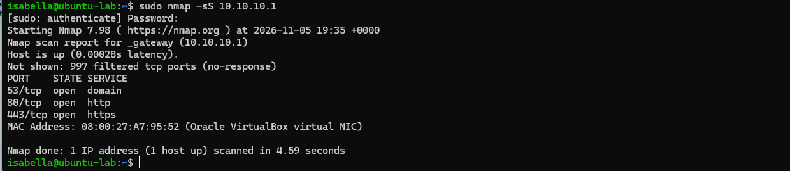 **Saída do `nmap -sS`** | 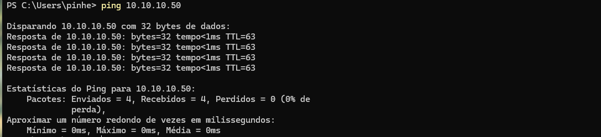 **Ping até a Ubuntu (TTL=63)** |
| 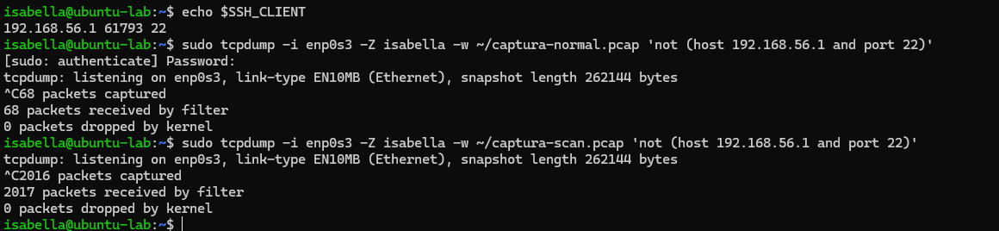 **Contagem de pacotes do tcpdump** | 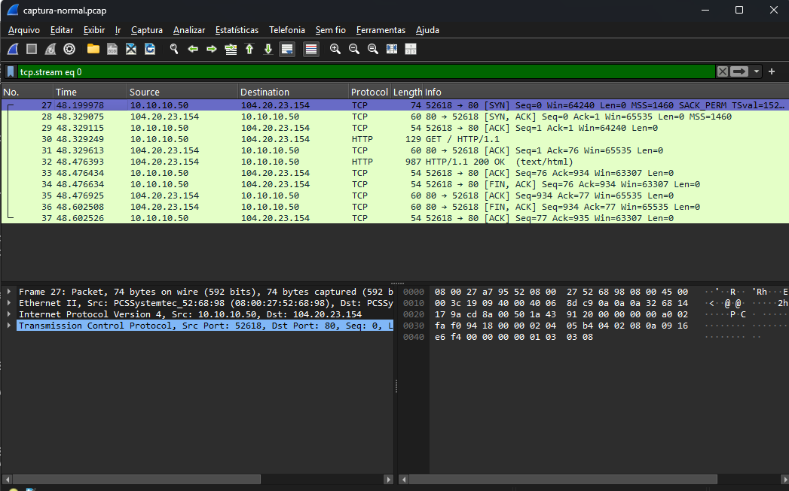 **Handshake TCP completo** |
| 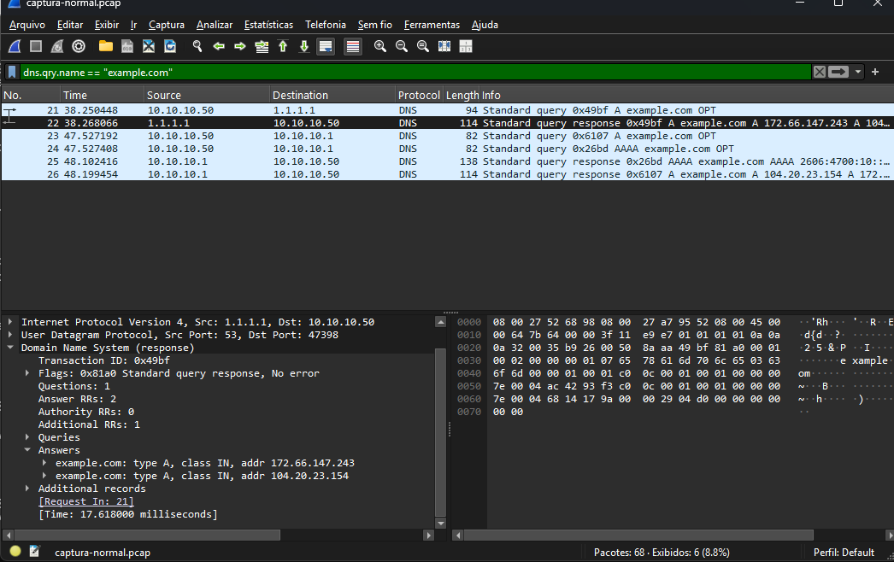 **Consultas DNS** | 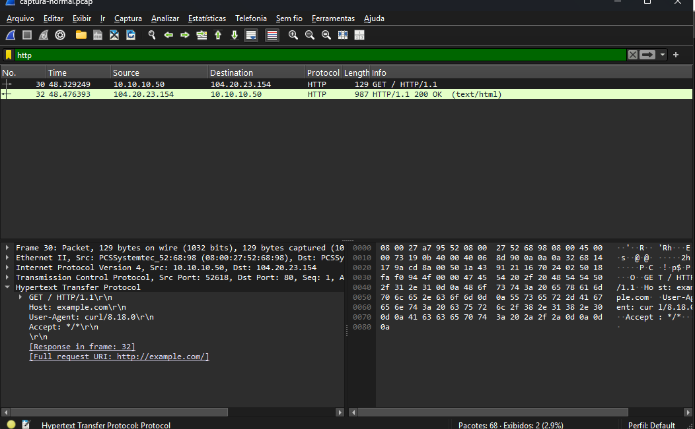 **Requisição e resposta HTTP** |
| 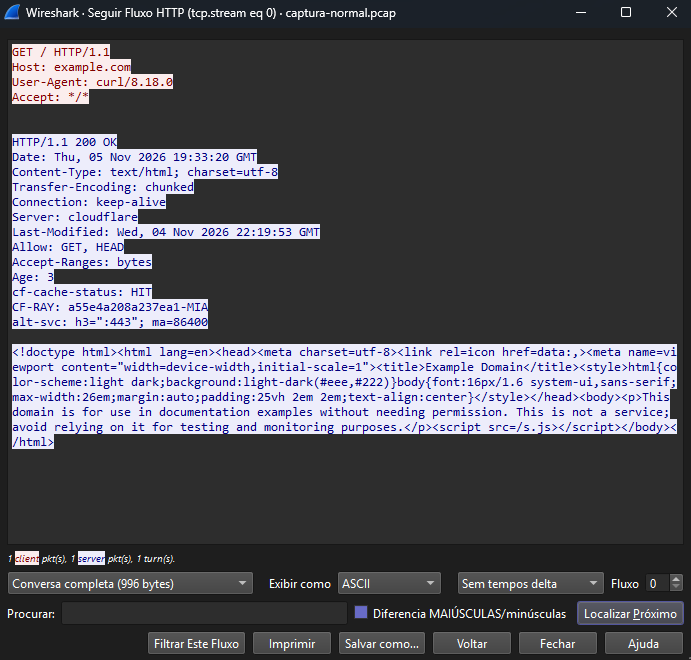 **Fluxo HTTP completo** | 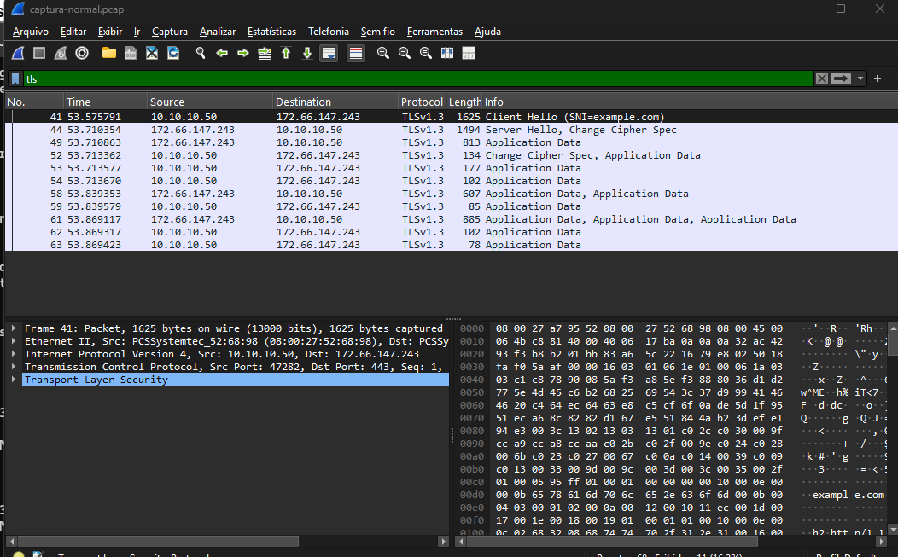 **Handshake TLS 1.3 cifrado** |
| 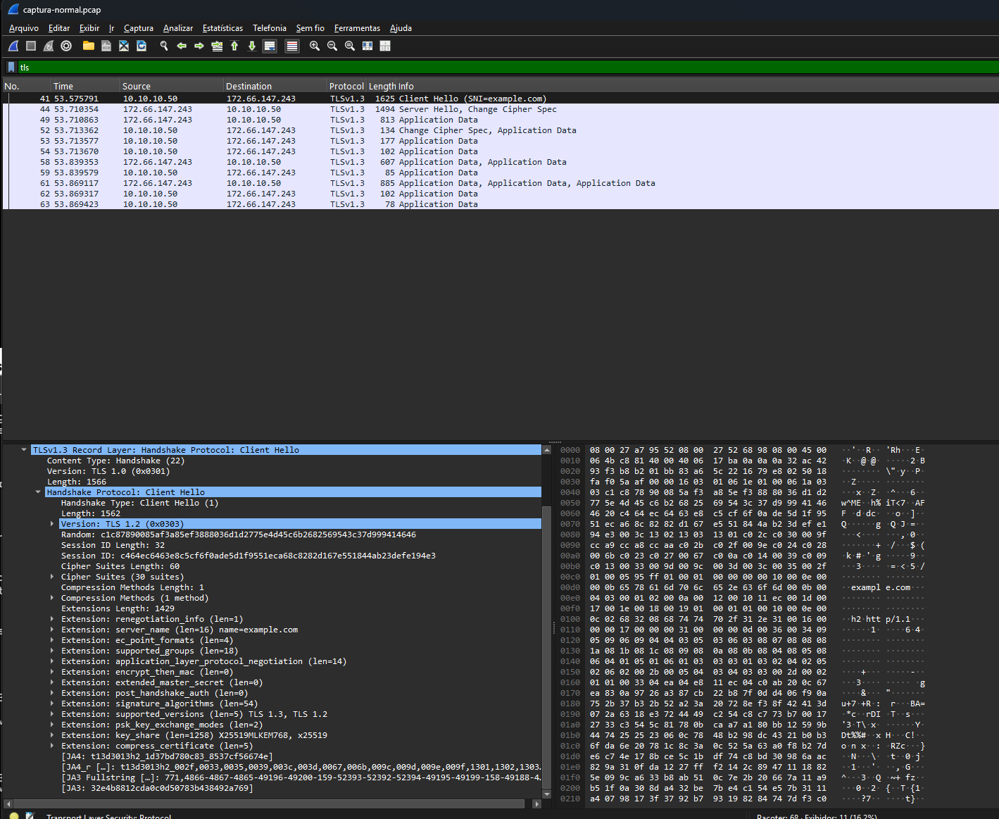 **SNI no Client Hello** | 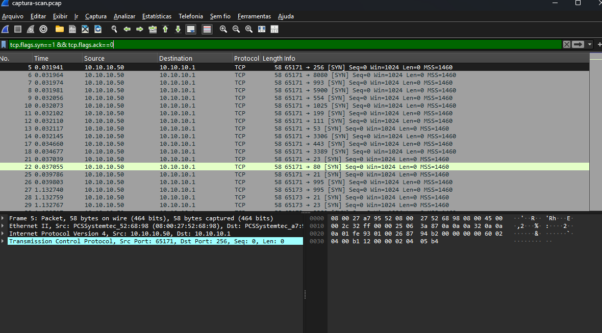 **SYNs do scan, um por porta** |
| 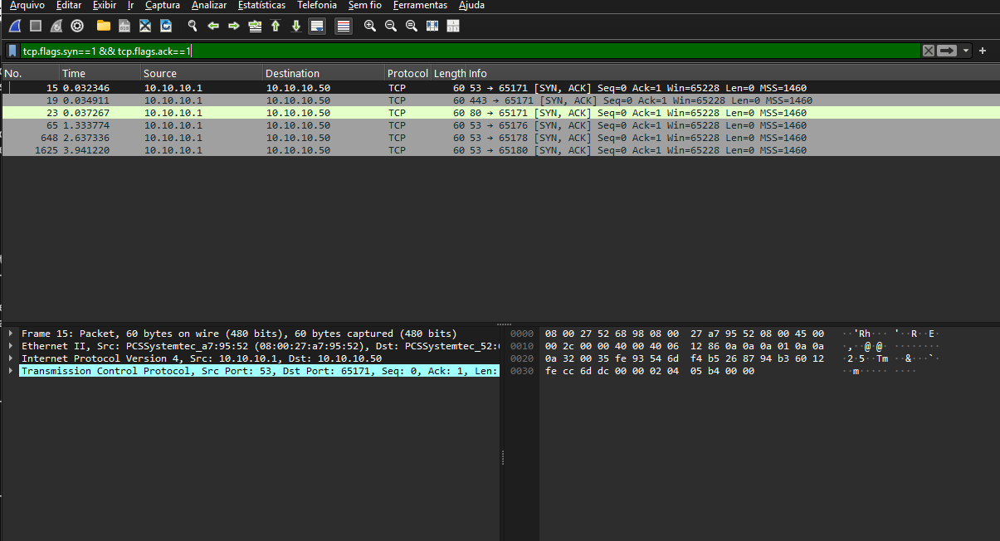 **SYN-ACK das portas abertas** | 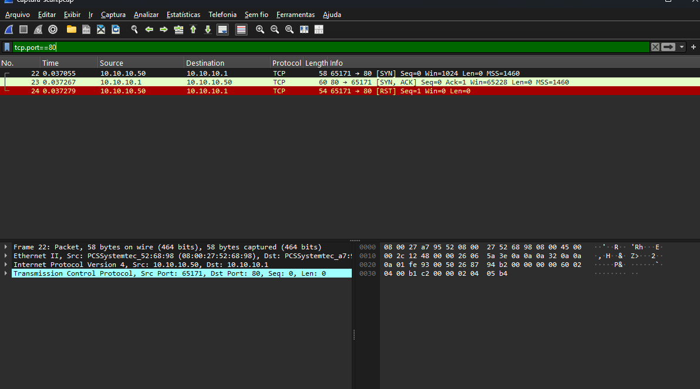 **Half-open na porta 80** |
| 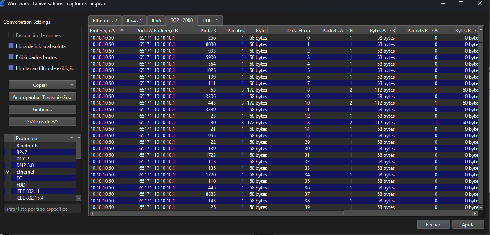 **Conversas TCP do scan** | 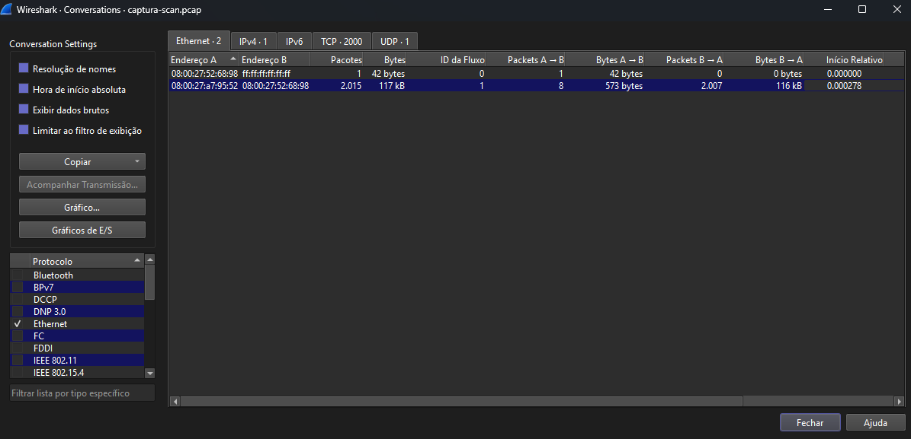 **Estatísticas Ethernet do scan** |

## Topologia

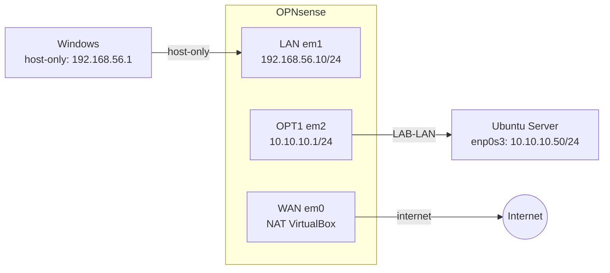

| Máquina | Interface | IP | Rede |
|---|---|---|---|
| Windows (host) | adaptador host-only | 192.168.56.1 | host-only |
| OPNsense | LAN (em1) | 192.168.56.10/24 | host-only |
| OPNsense | OPT1 (em2) | 10.10.10.1/24 | LAB-LAN |
| OPNsense | WAN (em0) | NAT do VirtualBox | internet |
| Ubuntu Server | enp0s3 | 10.10.10.50/24 | LAB-LAN |

## Tecnologias utilizadas

**Captura e análise**
- tcpdump
- Wireshark 4.6.9

**Scan e geração de tráfego**
- nmap 7.98
- ping, dig, curl

**Ambiente**
- OPNsense 26.7 (firewall)
- Ubuntu Server 26.04 LTS
- VirtualBox

**Acesso e transferência**
- SSH
- SCP

## O que o projeto faz

- Guarda as duas capturas brutas em [`pcaps/`](pcaps/): `captura-normal.pcap` (68 pacotes) e `captura-scan.pcap` (2016 pacotes).
- Reúne em [`guia-de-filtros.md`](guia-de-filtros.md) todos os filtros de captura e de exibição que usei no Wireshark, com o que cada um mostra.
- Documenta, com prints, a diferença entre o handshake TCP normal e o padrão half-open de um SYN scan.
- Mostra onde o conteúdo de uma conexão fica visível em texto claro (DNS, HTTP, SNI do TLS) e onde fica cifrado (payload do HTTPS).

## Como reproduzir

Pré-requisitos: as duas VMs da topologia (OPNsense e Ubuntu Server) já configuradas no VirtualBox, com a Ubuntu acessível por SSH a partir do Windows (host).

1. No Windows, criar a rota temporária para alcançar a LAB-LAN sem quebrar o isolamento das redes:
   ```
   route add 10.10.10.0 mask 255.255.255.0 192.168.56.10
   ```
2. Confirmar que o tráfego passa pelo firewall:
   ```
   ping 10.10.10.50
   ```
   (o TTL=63 na resposta mostra o salto pelo OPNsense)
3. Acessar a Ubuntu por SSH:
   ```
   ssh isabella@10.10.10.50
   ```
4. Iniciar a captura da navegação normal:
   ```
   sudo tcpdump -i enp0s3 -Z isabella -w ~/captura-normal.pcap 'not (host 192.168.56.1 and port 22)'
   ```
5. Em outra sessão, gerar o tráfego:
   ```
   ping -c 4 8.8.8.8
   dig @1.1.1.1 example.com
   curl http://example.com
   curl -s https://example.com -o /dev/null
   ```
   e parar a captura.
6. Repetir a captura, agora gerando o scan:
   ```
   sudo tcpdump -i enp0s3 -Z isabella -w ~/captura-scan.pcap 'not (host 192.168.56.1 and port 22)'
   sudo nmap -sS 10.10.10.1
   ```
7. Copiar as duas capturas pro Windows:
   ```
   scp isabella@10.10.10.50:~/captura-*.pcap .
   ```
8. Abrir os `.pcap` no Wireshark e aplicar os filtros descritos em [`guia-de-filtros.md`](guia-de-filtros.md).

## O que aprendi

- Precisei da rota temporária no Windows porque o host-only e a LAB-LAN são redes separadas pelo firewall; o TTL=63 (em vez de 64) foi a prova visual de que o tráfego realmente passou por um salto a mais, o OPNsense.
- Vendo os dois SYNs lado a lado deu pra entender a diferença entre uma conexão normal e um scan: o do nmap tem porta de origem fixa e janela bem menor (Win=1024 contra Win=64240 do curl), e o RST que fecha a conexão na porta aberta é disparado pelo próprio sistema da Ubuntu, não pelo nmap.
- Mesmo com o conteúdo do HTTPS cifrado, o nome do site continua visível em texto claro no SNI do Client Hello, o que mostra que TLS esconde o conteúdo mas não esconde qual site está sendo acessado.

## Próximos passos

O próximo projeto da sequência é detectar esse mesmo SYN scan automaticamente, usando um IDS como o Suricata.

## Autora

Feito por **Isabella Pinheiro Galuski da Cruz** · [LinkedIn](https://www.linkedin.com/in/isabella-pinheiro-7b8b572b8)
